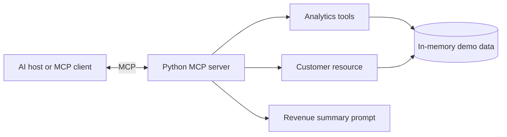

# PS Chatbot: Business Analytics MCP Server

A small Model Context Protocol (MCP) server that exposes fictional business customer data through tools, a resource, and a prompt. It is designed as a practical portfolio and interview demo.

## Architecture



## What it demonstrates

**Tools**
- `get_total_revenue()`: total revenue in EUR.
- `get_top_customers(limit)`: customers ranked by revenue.
- `search_customer(name)`: search by customer name.
- `create_customer(customer_id, name, revenue)`: add a customer to the in-memory dataset.

**Resource**
- `business://customers`: customer directory in JSON format.

**Prompt**
- `revenue_summary`: a reusable prompt for analyzing the customer data.

The sample data is fictional and resets whenever the server restarts.

## Requirements

- Python 3.10 or newer
- pip

## Run locally

Clone the repository, then run:

```bash
python -m venv .venv
source .venv/bin/activate
# Windows: .venv\Scripts\activate
pip install -r requirements.txt
```

Start the MCP server over stdio:

```bash
python server.py
```

The server waits for an MCP client on standard input/output. It is not intended to be opened directly in a browser.

## Test with the included client

In a second terminal, with the virtual environment activated:

```bash
python client.py
```

The client starts the server as a subprocess, lists its tools, and calls the revenue and top-customer tools.

## Inspect with MCP Inspector

Install the MCP CLI tools from the dependency above, then run:

```bash
mcp dev server.py
```

This opens MCP Inspector so you can connect to the server and explore its tools, resource, and prompt.

## Example interview walkthrough

1. Explain that MCP standardizes how an AI application discovers and uses external capabilities.
2. Start the server and connect using an MCP client or Inspector.
3. Show tool discovery with `list_tools`.
4. Call `get_total_revenue` and `get_top_customers`.
5. Read the `business://customers` resource.
6. Explain how authentication, persistent storage, authorization, logging, and input validation would be added for production.

## Production considerations

This repository is a learning demo, not a production service. A real deployment should use persistent storage, authenticate clients, authorize each operation, validate inputs, apply rate limits, log access safely, and avoid exposing sensitive customer data.

## References

- [Model Context Protocol documentation](https://modelcontextprotocol.io/)
- [Official Python SDK](https://github.com/modelcontextprotocol/python-sdk)
