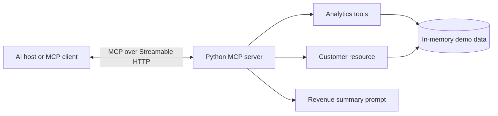

# PS Chatbot: Business Analytics MCP Server

A small Model Context Protocol (MCP) server exposing fictional business customer data through tools, a resource, and a prompt. It is designed as a practical portfolio and interview demo.

## Architecture



## Capabilities

**Tools**
- `get_total_revenue()`: total revenue in EUR.
- `get_top_customers(limit)`: customers ranked by revenue.
- `search_customer(name)`: search by customer name.
- `create_customer(customer_id, name, revenue)`: add a customer to the in-memory dataset.

**Resource**
- `business://customers`: customer directory in JSON format.

**Prompt**
- `revenue_summary`: reusable prompt for analyzing the customer data.

The sample data is fictional and resets whenever the server restarts.

## Deploy on Render

This repository includes a `render.yaml` Blueprint. In Render:

1. Open [Render Dashboard](https://dashboard.render.com/).
2. Select **New** > **Blueprint**.
3. Connect the GitHub repository `thekuldeepjoshi/PS-chatbot`.
4. Render reads `render.yaml` and creates the web service.
5. When deployment completes, your MCP endpoint is `https://YOUR-SERVICE.onrender.com/mcp`.

You can also create a Web Service manually with:
- Runtime: **Python 3**
- Build command: `pip install -r requirements.txt`
- Start command: `python server.py`
- Branch: `main`

The server binds to `0.0.0.0` and uses Render's `PORT` environment variable.

## Run locally

Requirements: Python 3.10 or newer.

```bash
python -m venv .venv
source .venv/bin/activate
# Windows: .venv\Scripts\activate
pip install -r requirements.txt
python server.py
```

The local MCP endpoint is `http://localhost:10000/mcp`.

## Test with MCP Inspector

With the virtual environment activated:

```bash
mcp dev server.py
```

Connect to the server and explore its tools, resource, and prompt.

## Interview walkthrough

1. Explain that MCP standardizes how an AI application discovers and uses external capabilities.
2. Connect an MCP client to the deployed `/mcp` endpoint.
3. Discover the tools and call `get_total_revenue` and `get_top_customers`.
4. Read the `business://customers` resource.
5. Explain how authentication, persistent storage, authorization, logging, and validation would be added for production.

## Production considerations

This is a learning demo, not a production service. A real deployment should use persistent storage, authenticate clients, authorize each operation, validate inputs, apply rate limits, log access safely, and avoid exposing sensitive customer data.

## References

- [Model Context Protocol documentation](https://modelcontextprotocol.io/)
- [Official Python SDK](https://github.com/modelcontextprotocol/python-sdk)
- [Render Web Services](https://render.com/docs/web-services)
